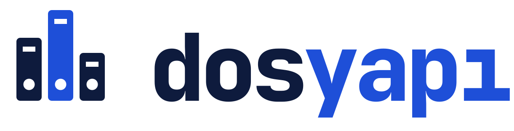
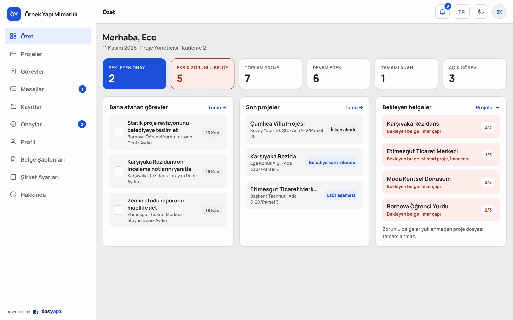
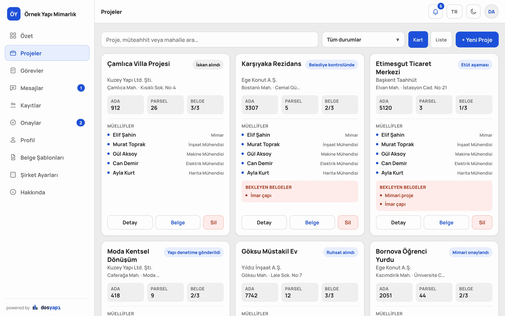
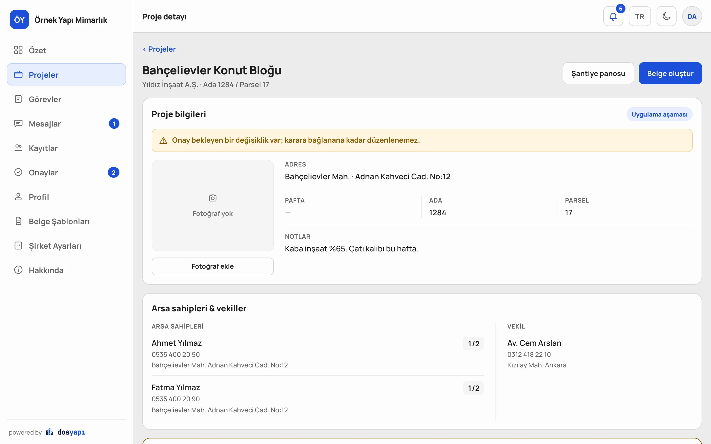
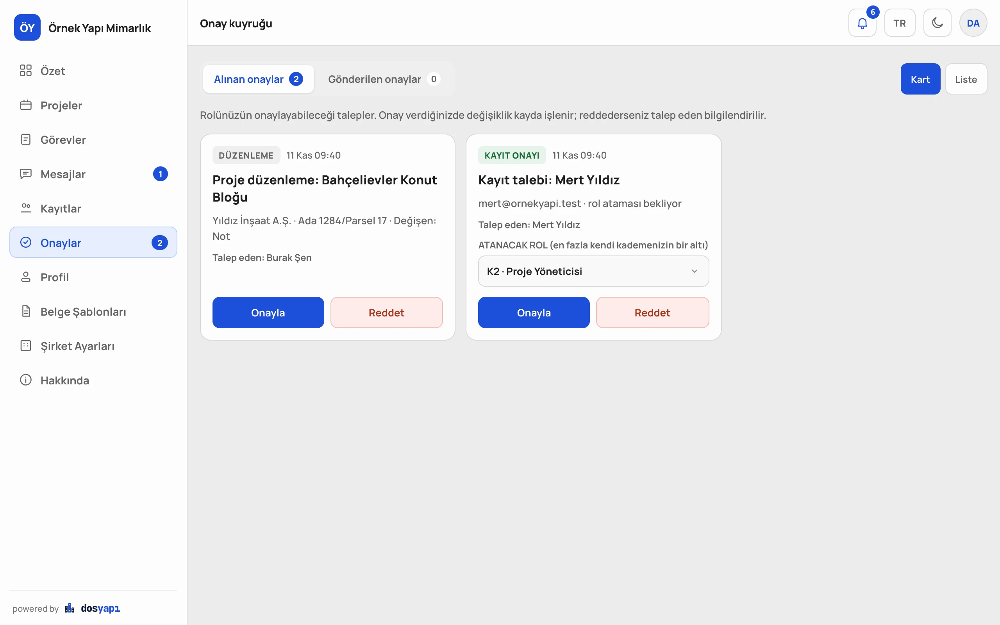
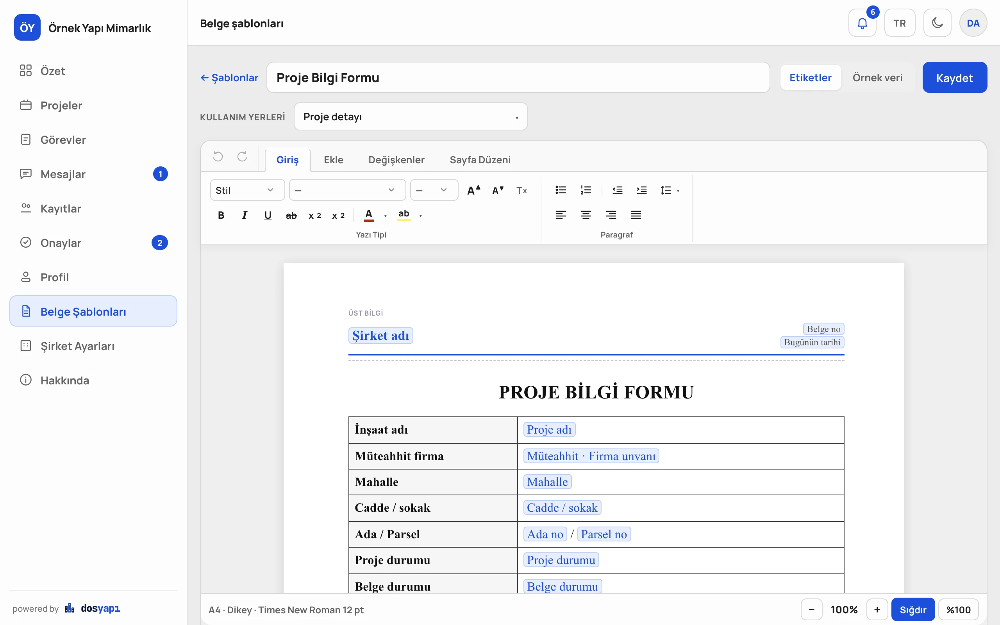
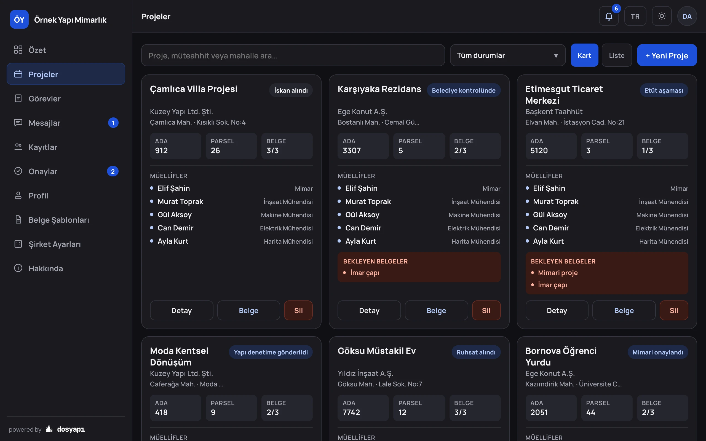
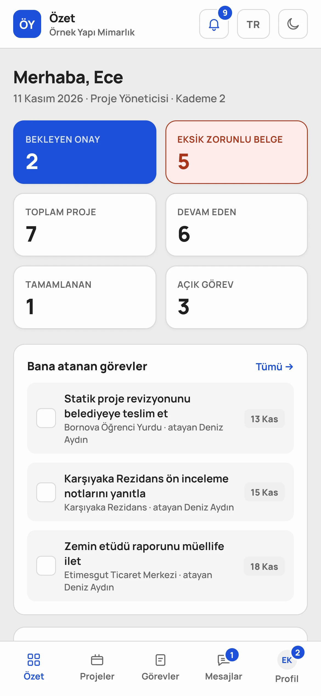
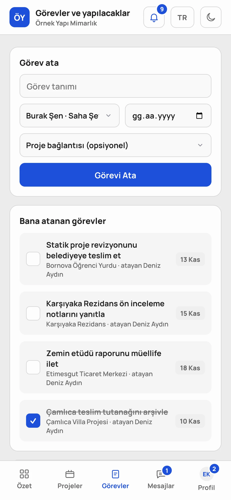

<p align="center">
  <picture>
    <source media="(prefers-color-scheme: dark)" srcset="docs/assets/logo-dark.svg">
    
  </picture>
</p>

<p align="center">
  <b>Şantiyenin dosyası cebinde.</b><br>
  İnşaat ve mimarlık ofisleri için kendi sunucunuzda çalışan proje dosyası, belge ve ekip yönetimi.
</p>

<p align="center">
  
  
  
  
  
</p>

<p align="center">
  <a href="#özellikler">Özellikler</a> ·
  <a href="#kurulum">Kurulum</a> ·
  <a href="#güvenlik">Güvenlik</a> ·
  <a href="#geliştirme">Geliştirme</a> ·
  <a href="docs/KURULUM.md">Kurulum kılavuzu</a>
</p>

<p align="center">
  
</p>

---

Bir proje dosyası; tapu, imar çapı, mimari proje, müellifler, arsa sahipleri ve onlarca yazışmadan oluşur. dosyapı
bunları tek yerde toplar: kim neyi yükledi, hangi belge eksik, hangi değişiklik onay bekliyor, hangi görevin süresi
geçti, hepsi bir bakışta görünür. Belge şablonları proje bilgileriyle kendiliğinden dolar; dilekçe ve formlar tek
tıkla PDF ya da Word olur.

Her şirket kendi sunucusuna kurar ve veri şirketin kendisinde kalır. Kurulum tek komuttur: ayrı veritabanı
servisi yoktur, sunucu ve arayüz tek bir ikili dosyadadır. Arayüz telefonda ve masaüstünde tarayıcıdan çalışır.

## Özellikler

**Proje dosyası**
- Projeler, iş durumları (etüt → iskân), zorunlu ve seçmeli belge ağacı, ek dosyalar
- Proje ekranında yerinde düzenleme: fotoğraf, adres, pafta, ada, parsel, notlar
- Arsa sahipleri ve vekiller; hisse toplamının 1/1 olması denetlenir
- Müellif ve müteahhit kayıtları, proje başına meslek bazlı müellif ataması
- Projeye kişisel not: yalnızca yazan görür, kendiliğinden kaydedilir

**Ekip**
- Rol ve kademe tabanlı yetki; alan bazlı onay kuyruğu, talebi geri çekme, silmeyi geri alma
- Görevler ve yapılacaklar; süresi geçen görevler için uyarı (atanan kişiye ve atayana)
- Kullanıcılar arası birebir mesajlaşma
- **Canlı güncelleme:** başka bir oturumda yapılan değişiklik sayfa yenilenmeden görünür

**Belge üretimi**
- Word benzeri şablon düzenleyici: tablolar, görseller, üst/alt bilgi, sayfa numarası
- Değişkenler (proje adı, müellifler, arsa sahipleri…) belge oluşturulurken dolar; boyut ve renkleri ayarlanabilir
- Metni seçilebilir PDF, gerçek Word (.docx) ve yazdırma çıktısı
- Şantiye panosu ve QR kod

**İşletim**
- Tek komutla Docker kurulumu, otomatik HTTPS (Let's Encrypt), yönetim aracı `dosyapi-ctl`
- İmzalı güncellemeler; açılmayan sürümde önceki sürüme otomatik dönüş
- Tam yedek: veritabanı ve dosyalar tek dosyada, şifreli ve doğrulanabilir; zamanlanabilir otomatik yedek,
  panelden indirme ve bozuk ya da değiştirilmiş yedeği yakalayan doğrulama
- Sistem Paneli: şirket kimliği, roller, kullanıcılar, sunucu dosyaları, alan adı ve DNS, e-posta, güncelleme,
  yedek, denetim günlüğü
- KVKK aydınlatma metni onayı ve kişisel veri erişim günlüğü
- Türkçe / İngilizce, açık / koyu tema, telefona uygun arayüz

## Ekran görüntüleri

<table>
  <tr>
    <td width="50%"><br><sub><b>Projeler</b>: durum, belge ilerlemesi ve müellifler tek kartta</sub></td>
    <td width="50%"><br><sub><b>Proje detayı</b>: yerinde düzenleme, arsa sahipleri ve vekil</sub></td>
  </tr>
  <tr>
    <td width="50%"><br><sub><b>Onay kuyruğu</b>: alt kademenin değişiklikleri onaya düşer</sub></td>
    <td width="50%"><br><sub><b>Şablon düzenleyici</b>: değişkenler belge oluşturulurken dolar</sub></td>
  </tr>
</table>

<p align="center">
  <br>
  <sub><b>Koyu tema</b></sub>
</p>

<p align="center">
  
  &nbsp;&nbsp;
  <br>
  <sub><b>Telefonda</b>: alt gezinme çubuğu, aynı özellikler</sub>
</p>

<sub>Ekran görüntülerindeki şirket, kişi ve proje bilgileri kurgusaldır.</sub>

## Kurulum

Gerekenler: Ubuntu/Debian gibi bir Linux sunucu (1 GB RAM yeterli) ve sunucunun IP'sini gösteren bir alan adı.

```bash
curl -fsSL https://raw.githubusercontent.com/ozdemiromer26/dosyapi/main/deploy/kur.sh | sudo bash -s -- --domain dosya.sirket.com
```

Betik Docker'ı (yoksa) kurar, uygulamayı ve HTTPS sertifikasını alan Caddy'yi başlatır, sonunda adresi ve tek
kullanımlık **kurulum belirtecini** yazar. Hazır imaj henüz yayınlanmadıysa uygulamayı sunucuda kaynak koddan
derlemeyi önerir.

1. Tarayıcıdan adresi açın. Kurulum sihirbazı dört adımdır: belirteç, şirket adı, Sistem Paneli şifresi, ilk yönetici.
2. Sistem Paneli'ne `https://dosya.sirket.com/#sistem` adresinden girin. Önce iki adımlı doğrulamayı açın, sonra
   e-posta (SMTP), roller ve kullanıcıları ayarlayın.

| Komut | Ne yapar |
| --- | --- |
| `sudo dosyapi-ctl status` | Servisler, sürüm, adres |
| `sudo dosyapi-ctl update` | Önce yedek alır, yeni sürüme geçer; sağlıklı açılmazsa geri döner |
| `sudo dosyapi-ctl backup [klasör]` | Tam yedek (veritabanı + dosyalar, şifreli) alır ve doğrular |
| `sudo dosyapi-ctl restore <yedek>` | Yedeği doğrulayıp geri yükler; mevcut veri kenara alınır |
| `sudo dosyapi-ctl logs -f` | Canlı günlük |

Docker olmadan systemd ile kurulum, ters vekil (nginx), yedekten dönme ve tüm seçenekler:
**[docs/KURULUM.md](docs/KURULUM.md)** · Alan adı: [docs/DNS.md](docs/DNS.md) · Güncelleme: [docs/GUNCELLEME.md](docs/GUNCELLEME.md)

## Güvenlik

dosyapı kişisel veri (TC kimlik numarası, telefon, adres) tuttuğu için güvenlik baştan tasarlandı:

- TC, telefon, adres, mesajlar ve kişisel notlar veritabanında **AES-256-GCM** ile alan düzeyinde şifreli; dosyalar diskte şifreli
- Parolalar **Argon2id**; iki adımlı doğrulama (TOTP) ve tek kullanımlık kurtarma kodları
- Her istekte sunucu tarafı yetki denetimi; CSRF belirteci, katı CSP, SameSite=Strict çerezler
- Denetim günlüğü değiştirilemez hash zinciri; doğrudan veritabanı müdahalesi tespit edilir
- Güncellemeler Ed25519 imzalı; sürüm geri alma saldırısı engellenir
- Yedekler kimlik doğrulamalı şifreli (AES-256-GCM): tek bayt değişikliği, kesilme ya da başka anahtarla üretilmiş yedek
  geri yüklemeden önce yakalanır
- CI her değişiklikte gerçek bir sunucuya karşı **440 saldırı senaryosu** koşar (yetki aşımı, IDOR, enjeksiyon, CSRF,
  yol geçişi, yedek kurcalama…); sürüm derlemesi gerçek Argon2id ile 450 senaryodan geçer

Tehdit modeli, kapsam dışı kalanlar ve açık bildirimi: [SECURITY.md](SECURITY.md) · Test raporu: [docs/SIZMA-TESTI.md](docs/SIZMA-TESTI.md).
Testler yazılımı yazan tarafındır; canlıya almadan önce bağımsız bir sızma testi önerilir.

## Geliştirme

Gerekenler: Rust 1.95+, Node.js 22+.

```bash
cd web && npm ci && npm run build && cd ..
cargo run -p dosyapi -- --config ./dev.toml init --data-dir ./data --secret-key ./dev.key
cargo run -p dosyapi -- --config ./dev.toml serve
```

Arayüzü anında yenilemeyle geliştirmek için sunucu çalışırken `cd web && npm run dev` (Vite, `/api` isteklerini
8080'e yönlendirir).

| Komut | Ne yapar |
| --- | --- |
| `make test` | Rust testleri, clippy, TypeScript denetimi |
| `make pentest` | Geçici bir sunucuya karşı saldırı senaryoları |
| `make audit` | Bilinen açık taraması (Rust ve npm) |

### Mimari

```
crates/dosyapi-core    İş kuralları, yetki politikası, portlar. HTTP, SQL ve kripto bilmez.
crates/dosyapi-infra   Portların uygulamaları: SQLite, AES-256-GCM, Argon2id, SMTP, DNS, imzalı güncelleme.
crates/dosyapi         HTTP katmanı (axum), CLI ve bileşim kökü. Web arayüzü ikiliye gömülür.
web/                   React + TypeScript. Ekranlar, görünüm modeli (vm/) ve API istemcisi ayrıdır.
security/              Sızma testi ve güncelleme saldırı testleri.
deploy/                Docker kurulumu (kur.sh, dosyapi-ctl, Caddy), systemd ve nginx örnekleri.
```

Bağımlılık yönü tek yönlüdür: `dosyapi → infra → core`. `core` dış dünyayı yalnızca `ports.rs` içindeki dar
arayüzlerle görür; yeni bir DNS sağlayıcısı ya da depo eklemek çekirdeği değiştirmez.

---

<details>
<summary><b>In English</b></summary>

**dosyapı** is a self-hosted project-file and document management app for construction and architecture offices
in Turkey: projects with required-document tracking, licensed professionals and contractors, land owners and shares,
a role/level based approval queue, tasks with overdue warnings, direct messages, live updates across sessions, and a
Word-like template editor that fills documents from project data and exports text-selectable PDF and real `.docx`.

It ships as a single Rust binary with the React UI and SQLite embedded. One command installs it with Docker and
automatic HTTPS. Personal data is encrypted at field level (AES-256-GCM), updates are Ed25519-signed, and CI runs
440 attack scenarios against a live server on every change (450 for the release build). Full backups (database and
files) are a single encrypted, authenticated file that is verified before restore. The UI is available in Turkish and English.
See [docs/KURULUM.md](docs/KURULUM.md) for installation and [SECURITY.md](SECURITY.md) for the threat model.

</details>
